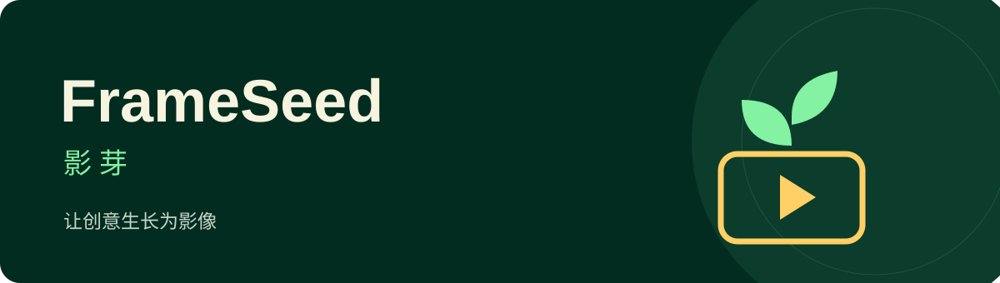

### 让创意生长为影像

从一个灵感出发，探索 AI 与影像创作的更多可能。

**AI 视频创作 · Skills · 创作工具**

## 我们想做什么

影芽关注 AI 视频创作中的每一步，逐步积累可复用的 Skills、工作流和工具，让创作者把精力投入故事与表达。

| 创作方向 | 探索内容 |
| --- | --- |
| 🎬 故事与镜头 | 创意构思、剧本、分镜与镜头语言 |
| 🌿 生成与制作 | 图像与视频生成、角色和画面风格 |
| 🎙️ 声音与剪辑 | 配音、字幕、配乐与后期编排 |
| 🧩 Skills 与 Agent | 可复用的创作能力与自动化工作流 |

## 从这里开始

项目正在起步，我们会随着实际创作逐步发布 Skills 与工具。

欢迎关注组织仓库，在具体项目的 Issue 中交流创作想法、使用体验和改进建议。
